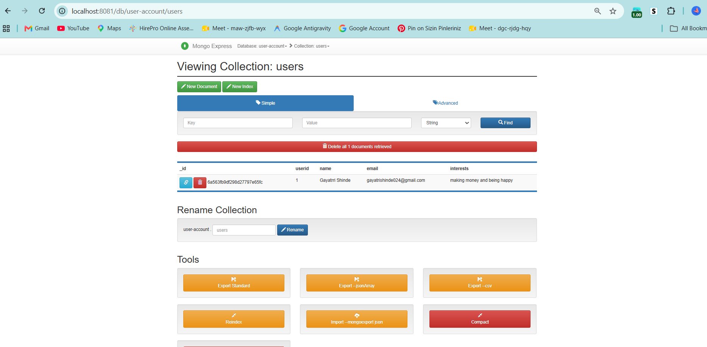

# MongoDB Profile App using Docker

## Project Overview

This project demonstrates how to build a simple **Node.js Profile Application** connected to a **MongoDB** database running inside Docker containers. The database is managed using **Mongo Express**, allowing profile information to be viewed and edited through a web interface.

The application retrieves user details from MongoDB and displays them on a web page. Any changes made through Mongo Express are reflected in the application after refreshing the page.

---

## Tech Stack

* Node.js
* Express.js
* MongoDB
* Mongo Express
* Docker
* HTML
* CSS
* Git & GitHub

---

## Project Structure

```text
Docker/
└── 02-MongoDB-Profile-App/
    ├── index.html
    ├── server.js
    ├── package.json
    ├── package-lock.json
    ├── .gitignore
    ├── README.md
    └── node_modules/
```

---

## Prerequisites
* Docker Desktop

---

## Features

* Display user profile from MongoDB
* Update profile information using Mongo Express
* Dynamic data retrieval using Node.js
* Dockerized MongoDB database
* Web-based MongoDB administration

---

## Project Workflow

```text
Browser (localhost:3000)
        │
        ▼
Node.js Application (Express Server)
        │
        ▼
MongoDB Database (Docker Container)
        ▲
        │
Mongo Express
```

---

## Steps Performed

### 1. Clone the Repository

```bash
git clone <repository-url>
cd Docker/02-MongoDB-Profile-App
```

### 2. Install Dependencies

```bash
npm install
```

### 3. Start MongoDB Container

```bash
docker run -d \
--name mongodb \
-p 27017:27017 \
-e MONGO_INITDB_ROOT_USERNAME=admin \
-e MONGO_INITDB_ROOT_PASSWORD=password \
mongo
```

### 4. Start Mongo Express

```bash
docker run -d \
--name mongo-express \
-p 8081:8081 \
-e ME_CONFIG_MONGODB_ADMINUSERNAME=admin \
-e ME_CONFIG_MONGODB_ADMINPASSWORD=password \
-e ME_CONFIG_MONGODB_SERVER=mongodb \
--network mongo-network \
mongo-express
```

> **Note:** Ensure both containers are connected to the same Docker network.

### 5. Run the Node.js Application

```bash
node server.js
```

Open:

```
http://localhost:3000
```

---

## Verify the Application

1. Open Mongo Express.

```
http://localhost:8081
```

2. Edit the profile document.

3. Save the changes.

4. Refresh the application.

The updated profile information should now be displayed on the webpage.

---

## Learning Outcomes

Through this project, I learned how to:

* Run MongoDB inside Docker.
* Connect a Node.js application to MongoDB.
* Use Mongo Express to manage database records.
* Store and retrieve data from MongoDB.
* Understand communication between the frontend, backend, and database.
* Work with Docker networking.
* Manage project source code using Git and GitHub.

---

## Future Improvements

* Docker Compose configuration
* Persistent Docker volumes
* CRUD operations (Create, Read, Update, Delete)
* User authentication
* Environment variables using `.env`
* Responsive UI improvements

---

## Screenshots

Add screenshots of:

* Running MongoDB contain

er
* Mongo Express dashboard


* Docker Desktop containers
* Terminal showing Node.js server
* Profile application in the browser


* Updated profile after editing in Mongo Express

---

## Author

**Gayatri Shinde**

Learning DevOps through hands-on projects involving Docker, Git, GitHub, Linux, Jenkins, AWS, and Node.js.
